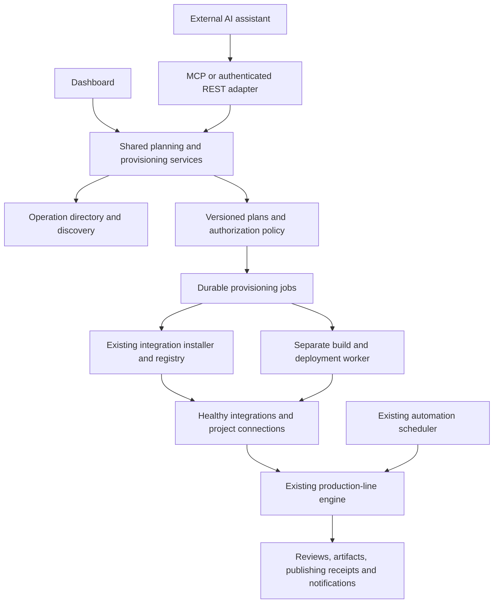

# AI-managed production lines

Status: the first deliverable now has an implementation for installed-operation discovery, revisioned plans, administrator approval, and disabled preview lines through MCP and authenticated REST. This scope was verified on 2026-10-20. Later milestones remain proposed; project discovery, installation/deployment, and recurring publishing are not implemented by this deliverable.

## Goal

Let a user ask an external AI assistant to build a recurring production line. The assistant identifies missing capabilities, searches for suitable projects or services, prepares integrations, requests installation, connects the approved operations, tests the line, and enables its schedule within the user's authorization.

Example request:

> Every day, research trending niches, choose a topic, write a video script, create the characters and other assets, generate a video, and publish it to my selected social accounts.

In this example, "persons" means fictional characters or avatars. Time, timezone, language, audience, video format, accounts, compute resources, spending limits, and publication permissions are explicit settings. The assistant requests missing settings and can continue researching candidates while answers are pending.

The deliverable is an installed, tested, scheduled Lynewright line. Gemini, Claude, another MCP client, or an HTTP-capable assistant can initiate the same process. Compatibility requires the client to support the exposed tool calls or authenticated HTTP API; a text-only model needs a tool-execution bridge.

## Important behavior

- Reuse installed, authorized operations before installing another project. Install only missing capabilities.
- Allow the assistant to discover projects beyond a curated catalogue. A new repository can become an integration through inspection, adaptation, isolated builds, and validation.
- Support automatic installs and recurring execution under a standing policy selected by the user. Ask again when a proposed action exceeds that policy, changes approved artifacts or permissions, or requires account sign-in.
- Execute daily runs on the Lynewright server after the planning chat closes. The chat assistant is not the scheduler.
- Distinguish an installed artifact from a running, healthy integration with configured credentials and usable operations.
- Describe unsupported projects and missing prerequisites accurately, and propose alternatives. Discovering a repository does not prove that it can run on the available hardware or serve the required function.

## Current foundations and gaps

The baseline was inspected in the source checkout and the published release export.

| Area | Existing foundation | Required addition |
| --- | --- | --- |
| Assistant access | `assistant_tools.py` exposes line/run/review tools through `mcp_server.py`; access is scoped | Discovery, planning, provisioning, line authoring, and schedule tools |
| Integration drafting | `integration_drafts.py` inspects a supplied GitHub repository, OpenAPI source, MCP endpoint, or pasted documentation | Search across sources, immutable source snapshots, candidate comparison, and adaptation jobs |
| GitHub projects | The helper can find an OpenAPI specification or suggest a CLI wrapper; an MCP repository still needs a running server | Build and deploy an approved repository and adapter; generated CLI drafts currently cannot be probed or enabled |
| Installation | `catalogue_installation.py`, `integration_install_policy.py`, and provenance services verify supported artifacts and enforce install policy | Durable orchestration of discovery, installation, deployment, configuration, and readiness |
| Catalogue | Signed index, exact artifact checks, and provenance | A usable production catalogue with real artifacts; bundled entries use development keys and placeholder URLs |
| Execution | Operation directory, line engine, async operations, media storage, isolated package runners | Deployment automation for missing services, dependency packaging, compute placement, and readiness checks |
| Native runners | Runtime config and runner tokens exist | Deployment currently needs operator steps; wheels use `--no-deps`, and runner egress currently supports only `none` or `internet` |
| Line authoring | Production-line REST endpoints and schema validation exist; create/update currently require tenant admin | An explicitly delegated authoring service shared by browser, MCP, and external REST callers |
| Scheduling | `operator_automation.py` already supports scheduled actions targeting `line_id`; `operator_schedule.py` validates daily/weekly/interval schedules and IANA timezones | Expose this through the new external capability service; add any missing ownership, revision, and overlap controls |
| Credentials | Project connections, named credential references, secret storage, and integration OAuth routes exist | Plan-bound setup links and connection readiness; no raw secrets returned to an external assistant |

The existing GitHub helper drafts integrations from source material; it does not install arbitrary repositories. Keep that declarative path and add a separate adaptation/build service for executable software.

## User experience

1. The user connects an assistant and grants permission to plan automations for selected projects.
2. The assistant reads Lynewright's capabilities, existing integrations, available compute, connection status, and the user's automation policy.
3. It converts the request into stages and lists missing functions. It asks for essential preferences such as target accounts, daily time, and budget.
4. It searches installed operations, trusted catalogues, and external sources. It can submit repository URLs it found with its own search tools, or use a configured Lynewright discovery provider.
5. Lynewright independently inspects the candidate sources, pins versions, checks compatibility, and produces an installation and line plan with evidence, costs, permissions, and alternatives.
6. The user authorizes the plan, or a standing policy authorizes eligible steps automatically. Sign-in links are provided for accounts that need connecting.
7. A durable job installs or prepares each missing integration, deploys its runtime where necessary, verifies its operations, and binds it to the project.
8. Lynewright compiles the stages, validates their data mappings, and runs a sample without publishing publicly.
9. The user enables the recurring schedule and the intended publication policy. Subsequent executions run independently of the chat.
10. The assistant can report progress, explain a failed stage, request a permitted retry, or pause the schedule.

Example assistant response during setup:

> I can reuse your research service. I found candidates for narration and rendering, and prepared the character-generation integration. The plan needs 6 GB of disk and an estimated budget of [amount and currency] per video. Connect your publishing account using this setup link. Once the plan is authorized, Lynewright will deploy the missing tools, run a preview, and prepare the daily schedule.

Amounts, storage requirements, and completion claims must come from inspected artifacts, measurements, or clearly labelled estimates. Never invent them.

## Architecture

Transport adapters call the same services. The MCP path must not call browser routes with an invented administrator context. Browser, MCP, REST, background jobs, and workers enforce the same tenant, project, resource, capability, and policy rules.

An external assistant can provide the reasoning and discovery. Lynewright validates and executes the resulting structured plan. An optional internal planner can use the same contracts later. Recurring AI stages need a configured model API or local model accessible to Lynewright: connecting a Gemini chat does not supply an API key or an always-running model service. Likewise, another app connected to Gemini does not automatically share its OAuth connection with Lynewright.

## Plan contract and persistent state

Introduce `AutomationPlanService` with immutable plan revisions. Store:

- Tenant, project, owner, originating assistant, objective, constraints, schedule proposal, budget, and expiration.
- Stage graph, input/output schemas, data mappings, installed-operation matches, and missing-capability requirements.
- Candidate evidence and rejected alternatives, including source URLs, inspection timestamp, licence, compatibility, and why the candidate meets a stage's requirements.
- For each selected component: source commit or release identity, artifact/image digest, integration/adapter version, dependency lock, runtime kind, hardware requirements, requested network access, credential references, and required operations.
- Deployment target, dependency graph, install/configuration/health state, output artifact references, and ownership of installed resources.
- Exact authorization scope, approving policy or user, approved plan hash, grants, limits, and expiry.
- Per-step jobs, attempts, leases, checkpoints, failure reasons, and cleanup records.

Prebuilt artifacts must have their exact digests before install authorization. A project that needs building instead pins its source, locked dependencies, build recipe, expected interface, permissions, and resource limits before build authorization. Record the resulting artifact digest as append-only build evidence bound to those approved inputs; deployment accepts only that verified output. A new permission requirement or changed input returns the plan for authorization. This supports automatic build-to-deploy execution under one bounded authorization without pretending an unbuilt image already has a digest.

Suggested new storage: `automation_plans`, `automation_plan_revisions`, `integration_candidates`, `provisioning_jobs`, `provisioning_steps`, `automation_authorizations`, and `deployment_resources`. Fit these into the existing store/schema initialization patterns with tenant/project indexes and uniqueness constraints.

Top-level states: `draft`, `awaiting_answers`, `awaiting_authorization`, `awaiting_connections`, `provisioning`, `validating`, `ready`, `active`, `paused`, `failed`, and `cancelled`. Keep per-component states separately: one unavailable component must not hide the state of the others.

Changing source bytes, dependency locks, permissions, target accounts, budget limits, or line behavior creates a new revision. Recheck whether the existing authorization covers it. Persist versions for running lines so a new installation cannot silently change a run already in progress.

## External tools and API

Names and routes below are proposed contracts. Use ordinary typed arguments, bounded results, structured errors, and stable IDs. Long operations return a job ID immediately.

| Proposed MCP tool | Purpose | Service/REST equivalent |
| --- | --- | --- |
| `platform.describe` | Supported features, effective grants, policy, and available compute | External capability descriptor |
| `operations.search` | Find installed operations by required function and schema | Operation-directory query |
| `integrations.discover` | Search configured sources or inspect assistant-supplied candidate references | Discovery service |
| `integrations.inspect` | Resolve candidate to pinned source, compatibility, permissions, and installability evidence | Candidate inspection job |
| `automation.plan` | Create or revise the stage, integration, deployment, and schedule proposal | `POST /api/automation/plans` and revision creation |
| `automation.get_plan` | Read plan, missing inputs, authorization/setup links, and jobs | `GET /api/automation/plans/{id}` |
| `automation.apply` | Request idempotent provisioning under an approved revision or standing policy | `POST /api/automation/plans/{id}/apply` |
| `connections.request_setup` | Return a bounded link for a user to sign in or configure a required secret | Plan-bound connection setup |
| `automation.validate` | Compile bindings and check operational readiness without running stages | Plan validation |
| `automation.test` | Run a sample with explicit sandbox/preview behavior and bounded costs | Test-run job |
| `automation.activate` | Enable the validated line and its approved schedule/publication policy | Activation service |
| `provisioning.get_job` / `provisioning.cancel_job` | Follow progress or stop new provisioning work | Job service |
| `automations.pause` / `automations.resume` | Manage an existing authorized schedule | Existing automation service with external access checks |

Reuse existing `lines.*`, `runs.*`, and `reviews.*` tools. Do not add an unrestricted shell/command tool to accomplish installation.

MCP and REST need resource-appropriate authentication. Reuse the OAuth/token machinery, with a documented REST resource/audience rather than accepting a token intended only for `/mcp` everywhere. Support explicitly scoped service credentials for assistants that cannot complete browser OAuth. Adapt webhooks or other future transports to the same service contracts and replay protections.

## Authorization and autonomy

Add explicit capabilities for discovery, plan writing, provisioning requests, connection setup, activation, and schedule management. Example scope families: `integrations:discover`, `automation:plan`, `automation:provision`, `connections:request-setup`, `automation:activate`, and `automations:manage`. Distinguish requesting an action from approving it.

New authority must require explicit delegation. `FULL_ACCESS_CAPABILITIES` currently aliases `PUBLIC_CAPABILITIES`; simply adding new scopes there would expand existing full-access tokens. Introduce versioned/explicit grants or an equivalent migration so old tokens do not automatically acquire installation, deployment, or publication authority. Add the scopes to OAuth consent and the assistant settings UI with clear descriptions.

Effective authority is the intersection of the client's grant, the authorizing user's current authority, selected tenant/project, plan authorization, deployment target, and installation/publication policy. Tenant-wide installs and host-resource changes require tenant/deployment-admin delegation. Preserve current admin requirements for line creation until an explicit delegation model is implemented.

Support two authorization paths:

- **Standing policy:** the user allows specified integration sources/versions, deployment targets, maximum spend/resources, operations, accounts, schedules, and publication behavior. Matching steps proceed automatically.
- **Plan authorization:** the user approves a concrete plan revision for work outside that standing policy. The server records the approval against its own inspection results and exact content hash.

Reuse `catalogue-only`, `confirm`, and `open` installation policies. An assistant cannot change that policy or add its own trusted signing key. `open` does not grant deployment permission or override resource limits. Keep install authorization separate from permission to publish to an account.

A user approval is a server-recorded decision by the authenticated authorized user. An assistant cannot supply `confirmed=true`, echo an approval hash, or call `reviews.decide` to authorize its own installation request. Those existing content-review tools must not become an installation approval shortcut.

The dashboard should offer a single review of the plan when possible. OAuth sign-in remains a direct user interaction; secret values and authorization codes stay out of AI-visible tool results. Existing connection references can be bound only where the owner has allowed their use.

Provisioning jobs and schedules use stored, bounded execution delegations, not a copied browser session or cached chat bearer token. Recheck delegation, current ownership, policy, and resource access before side effects. Closing the chat has no effect. Removing an assistant prevents new calls; already authorized daily execution continues only under its separately approved owner delegation. Revoking that delegation pauses future work. Expose pause and emergency-stop controls.

## Discovery, adaptation, and installation

1. **Inventory:** match stage requirements against installed operations using schemas, connection readiness, capability grants, and execution evidence.
2. **Discover:** search trusted catalogues and configured public discovery sources. Accept references found by the external assistant too. Preserve source evidence, timestamps, and search limits.
3. **Inspect:** fetch bounded metadata through the existing guarded HTTP path. Resolve mutable repository refs to exact commits before further fetches. Evaluate interfaces, licence, model/asset licences, maintenance signals, dependencies, compute, credentials, and stage compatibility. Popularity alone is not a trust decision.
4. **Choose a path:** connect an existing OpenAPI/MCP service; install an already packaged Lynewright integration; or prepare an adapter and runtime for a new repository. A hosted API connection does not require installing its server locally.
5. **Adapt when necessary:** define a typed operation contract, then generate/review the minimal adapter or CLI wrapper in a separate workspace. Support remote MCP directly; bridge stdio MCP only through an isolated managed process with lifecycle and authentication. Preserve the current declarative drafter's refusal to execute code.
6. **Freeze:** produce a deployment manifest with pinned source, dependency lock, build recipe, known hashes or prebuilt image digest, runtime permissions, model assets, required storage, and operation schemas. For builds, reserve the output artifact reference and bind its eventual digest to the approved build inputs. A changed input invalidates prior build/approval evidence.
7. **Authorize and queue:** apply the eligible standing policy or obtain plan authorization before executing source/build scripts or spending outside its bounds. Start a durable provisioning job and record each owned resource.
8. **Build, validate, and deploy:** stage source safely, reject archive traversal/symlink escapes, resolve dependencies in an isolated builder, scan outputs, and run bounded adapter/contract checks. Record the verified output digest and deploy it only within the approved target and permissions. Source README instructions are untrusted input; they cannot authorize host commands, secrets, mounts, or policy changes. Generated code remains untrusted too.
9. **Connect and verify:** bind approved named credentials and operation mappings, check readiness, and run permitted smoke probes. A probe that mutates a remote service needs sandbox data or explicit authorization; discovery is not permission to publish or charge an account.
10. **Activate:** make verified operations available to the line; retain source/build/health evidence and provenance.

Dependency resolution must handle the existing `--no-deps` runner limitation explicitly. Produce a reviewed locked runtime image or self-contained package instead of assuming that a downloaded wheel supplies its dependencies. GPU workloads also need compatible drivers, model licences, VRAM, downloaded model weights, and target-machine checks.

No automatic execution of a random repository's install script on the Lynewright host. This plan still supports arbitrary-source projects through the bounded adaptation and deployment path. Repositories that cannot pass that path remain candidates with specific unmet requirements and alternatives.

## Deployment worker

Add an opt-in deployment worker enrolled by a deployment administrator. Place it outside the API container. It accepts signed/authorized typed jobs for defined deployment targets, verifies the approved manifest, and reports artifact digests, resources, health, and cleanup state.

Start with one supported Linux container target; later add remote CPU/GPU targets and other deployment backends. Reuse existing runner token/config generation and invocation protocols. Container-engine permissions stay with the deployment worker; the API and integration containers do not receive the host Docker socket. Build source in a separate disposable environment with no production secrets or access to the control-plane database. Container isolation alone is not a guarantee against hostile code; unreviewed source builds need a separately isolated worker/VM boundary.

Enforce CPU, memory, GPU, disk, runtime, download, and network budgets. Before automatic deployment of unreviewed projects, implement enforced network policies for both build and runtime; the current `none`/`internet` option is insufficient for precise per-host restrictions. Block access to host/control-plane/metadata endpoints except explicitly enrolled service references. Separate build-time network needs from runtime needs.

Jobs use leases, heartbeats, idempotency keys, and checkpoints. A request retried by an AI or resumed after a restart attaches to the existing job. Cleanup removes only job-owned resources that are not referenced by other lines. Cancellation stops new work and records any non-reversible remote action rather than claiming rollback succeeded.

## Reference line: daily trend-to-video production

The core engine remains domain-neutral. Implement this as a versioned template and integrations with typed media/data contracts.

| Stage | Required capability | Output / validation |
| --- | --- | --- |
| Trigger | Existing daily scheduler, explicit time and IANA timezone | One run identity per intended time slot |
| Research niches | Search/trend source and document retrieval | Timestamped evidence, source links, niche candidates; distinguish observed trends from inferred topics |
| Select topic | Configured model plus saved preferences/history | Ranked topic, rationale, evidence, no repetition of recent topics |
| Write script | Text generation | Structured scenes, narration, claims/source links, timing, target language |
| Create characters | Character/avatar and image-generation integration | Consistent fictional character specifications and reusable asset references |
| Create audio/assets | Speech, captions, and media sources as needed | Typed media references with duration, format, provenance, and applicable usage information |
| Render video | Video generation and/or deterministic assembly | Asynchronous render job; final video, thumbnail, subtitle file, and technical metadata |
| Validate and preview | Media checks and review gate | Correct duration/aspect/codec, working audio, output preview, content checks selected by user |
| Publish | Supported social publishing integration and account OAuth | Account-specific uploads, confirmed remote IDs/URLs, per-account status |
| Report | Notifications and run history | Receipts, cost/resource usage, failed stages, actionable requests |

"AI video generation" and assembling images/audio into a video are separate candidate capabilities. A renderer cannot be labelled as a generative video model without evidence. Keep intermediate assets in Lynewright media storage, pass bounded references to operations, and retain character references across scenes/runs where authorized.

The first release should fully support one selected target social platform with its actual supported API/account requirements. Add other platforms through the same contract after validating their access requirements and media limits. Unsupported publishing accounts are a visible prerequisite, not a promise that installing a project can bypass the platform's access controls.

Default the first sample to preview and a review before publishing. The user can explicitly enable unattended publication for named accounts, content constraints, budgets, and schedule. That standing authorization avoids asking for every daily post. Account, permission, artifact, or policy changes require revalidation where they affect the approved behavior.

## Daily reliability and spending

- Reuse the existing automation scheduler and line action path; do not add a second cron engine or require Gemini to return each day.
- Persist the enabled line revision, provider bindings, owner delegation, and schedule timezone. Record missed executions, overlap behavior, and next due time.
- Choose a missed-run policy and an overlap policy explicitly. Start with no overlapping runs and one current run after downtime; do not generate a backlog of social posts automatically.
- Make publication idempotency persistent per run, account, and content identity. A timeout after upload means an unknown result: reconcile remote state or request intervention before retrying, so a retry does not duplicate a post.
- Retry transient failures with limits; keep successful expensive media stages and retry only failures. Bound total retry costs and do not replace an integration silently when it fails.
- Enforce model-call, render-time, download, storage, and publication limits on the server. Reserve an estimate before work and reconcile measured usage; unknown prices require an authorized cap and stop behavior. Coordinate concurrent workers against the same budget.
- Keep a scoped content-history store for topic/post deduplication and character continuity. Document retention and cleanup separately from reusable integration lifetimes.
- Record source evidence, plan/adapter revisions, approving identity/policy, installation/deployment results, cost evidence, and publication receipts in the audit trail. Redact secret values.

## Implementation milestones

Each milestone includes its behavior, likely touch points, and exit criteria. This is a staged release plan, not a claim that arbitrary repository installation is a small feature.

| Milestone | Work and likely files | Exit criteria |
| --- | --- | --- |
| 1. Shared authorization and contracts | New automation plan models/service/router; `platform_capabilities.py`, `mcp_oauth.py`, assistant settings; actor/resource checks | Same request through browser, MCP, and external REST has the same authorization result; existing tokens gain no new rights; immutable revisions and approvals work |
| 2. Assistant line planning | Operation-directory search, new planning tools, plan validation, reusable line-authoring service extracted from `production_lines.py` | Assistant creates a valid preview line using existing configured integrations; schema mismatches and missing requirements are visible |
| 3. Discovery and source inspection | New discovery service; extend candidate inspection around `integration_drafts.py`; pinned GitHub snapshots and source evidence | Assistant can search or submit repositories, compare compatible candidates, and explain unsupported ones without executing source code |
| 4. Durable provisioning for supported artifacts | New provisioning job services; reuse catalogue installer, file importer, provenance, installation policy, connections and lifecycle | Approved OpenAPI/MCP connections and packaged integrations become usable once; repeated requests/restarts do not duplicate resources; missing sign-in pauses and resumes setup |
| 5. Automatic runtime deployment | New enrolled deployment worker, deployment manifests, build isolation, enforced quotas/network rules; extend runner config support | A supported packaged runtime goes from approved install to healthy operation without manual Compose edits; API has no host container socket; worker failure recovers |
| 6. New-repository adaptation | Separate adaptation workspaces/jobs, CLI/stdio wrappers, locked dependencies, reproducible artifacts and contract checks | At least one previously unintegrated public repository becomes a versioned, isolated, usable integration; unsafe/unsupported candidates stop with useful reasons |
| 7. Daily trend-to-video template | Research, generation, character/audio/render adapters, content history, preview, one real publishing integration; existing schedule service | One request provisions missing tools, runs a representative preview, and produces one authorized scheduled post with a remote receipt; assistant chat can be closed |
| 8. Operational release | Setup/progress UI, documentation, installer enrollment, upgrades/cleanup, public export and CI coverage | End-to-end install from the public export works; cleanup preserves shared integrations; negative scenarios and recovery checks pass |

Suggested new backend files: `models/automation_plans.py`, `routers/automation_plans.py`, `services/automation_plans.py`, `services/integration_discovery.py`, `services/provisioning_jobs.py`, `services/integration_adaptation.py`, and `services/assistant_provisioning_tools.py`. Final names should follow existing project conventions during implementation.

Use a small number of product screens: plan preview with requested permissions/costs, secure connection setup, and provisioning progress with actionable blockers. Reuse Integrations, Lines, Reviews, and run history. Detailed hashes, deployment logs, and source evidence remain available in expandable technical details.

## Validation required before release

1. **Authorization:** cross-tenant/project denial, read-only client denial, expired/revoked delegations, model-supplied fake approval, legacy full-access migration, and REST audience validation.
2. **Source handling:** mutable-branch changes, changed dependencies after approval, signature/hash failures, malicious README instructions, unsafe archives, secret leakage, and private-network fetches.
3. **Provisioning:** duplicate calls, concurrent jobs, worker crashes, lost acknowledgements, build failure, missing GPU/disk, quota exhaustion, cleanup after partial installation, and shared integration reuse.
4. **Connections:** missing/expired OAuth, wrong-account binding, unavailable model provider, side-effectful probe restrictions, and no credentials in assistant results or logs.
5. **Line execution:** invalid mappings, missing schemas, async media readiness, restart during rendering, retained successful outputs, and changed integration revisions.
6. **Daily operation:** timezone/calendar changes, downtime, overlapping ticks, spending limits under concurrency, disconnecting the planning client, revoking execution authority, duplicate-publication prevention, and unknown remote upload outcomes.
7. **Transport parity:** a deterministic test assistant follows the complete flow through MCP and authenticated REST against the same service fixtures. Perform a representative live client smoke check when accounts/access are available.
8. **Product proof:** install from a fresh public release, use an actual supported external project, generate a complete preview, and publish a deliberately authorized sample to one selected social platform. Show the resulting remote ID/URL; a local success response alone is insufficient.

Use controlled fixtures for routine checks and explicit test/sandbox accounts for external side effects. Release claims must distinguish simulated steps from real integration results.

## First deliverable

The first deliverable covers transport-neutral plans, explicit permissions, installed-operation discovery, and assistant-created disabled preview lines after administrator approval. See [the automation plans API](../automation-plans-api.md) for its implemented scope. Continue with source discovery, supported installs, and automated deployment before arbitrary-source adaptation. The complete example is achieved at milestone 7, not by exposing an installer endpoint alone.

Product decisions needed before the reference template is activated: target social platform/account, daily time/timezone, target audience/language, video format, character style, available CPU/GPU or hosted providers, spending limit, and whether publication should run unattended. Those settings can be collected during implementation without blocking the generic planning and provisioning foundations.
